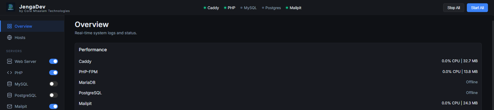

# JengaDev

**A portable, zero-config local dev server for Windows and Linux.** Caddy, PHP, MySQL/MariaDB, PostgreSQL, SQLite, and Mailpit, managed from one browser dashboard — with automatic local HTTPS out of the box.

[](https://github.com/mtaalamtech/jengadev/releases/latest)
[](https://github.com/mtaalamtech/jengadev/releases)


[](https://github.com/mtaalamtech/jengadev/releases/latest)
[](#linux)



## Why JengaDev

JengaDev gives you both for free, out of the box:

| Feature | JengaDev |
|---|---|
| Local HTTPS | **Automatic (Caddy)** |
| Mail catcher | **Built in (Mailpit)** |
| Databases | MySQL/MariaDB + PostgreSQL + SQLite |
| Control surface | Browser dashboard |
| Platforms | Windows, Linux |

## Features

- **One-click local HTTPS** for every hosted site via Caddy — no manual certificate setup.
- **Multiple databases** — MySQL/MariaDB, PostgreSQL, and SQLite, each with an admin UI (phpMyAdmin/Adminer).
- **Mailpit built in** — catch and inspect outgoing mail from every hosted site without touching a real SMTP server.
- **Per-host PHP error logs** with automatic size-based rotation, so logs stay manageable as the number of sites grows.
- **Switchable PHP versions** — pick from several PHP builds per project.
- **Browser dashboard** — start/stop services, manage hosts, databases, and PHP config from `http://127.0.0.1:4000`, opened automatically (with an authenticated session) when you launch JengaDev.
- **Auto-updater** — checks GitHub Releases for new versions; you approve every update explicitly.

## Installation

### Windows

1. Download the latest `JengaDev_Setup_Full_*.exe` from [Releases](https://github.com/mtaalamtech/jengadev/releases).
2. Run it (it requests admin rights once, to install services and secure its own install folder).
3. JengaDev starts and opens its dashboard automatically.

**Installer blocked with "Error 4551: An Application Control policy has blocked this file" / "part of this app has been blocked"?**

That's Windows 11's **Smart App Control**, not a regular antivirus warning - it blocks Inno Setup's self-extracted temp helper because this installer isn't code-signed yet, and unlike normal SmartScreen there's no "Run anyway" button for it. To install anyway: **Windows Security → App & browser control → Smart App Control → turn it Off**, then re-run the installer. If that setting is greyed out, Smart App Control has already locked into enforcement on that machine and unsigned software can't be installed without a Windows reinstall.

### Linux

Docker-based — Caddy, PHP, MariaDB, PostgreSQL, Mailpit, Adminer, and phpMyAdmin run as containers (prebuilt images, nothing compiles locally), and the daemon itself is a single compiled binary with no other dependencies.

```bash
git clone https://github.com/mtaalamtech/jengadev.git
cd jengadev/linux
./install.sh
```

Requires only Docker (the script installs it for you on Debian/Ubuntu and Fedora/RHEL if it's missing) - no Node.js, no local builds. The dashboard is reachable at `http://127.0.0.1:4000` and, since Linux dev boxes are often headless servers rather than desktops, over the LAN too; `install.sh` prints both tokenized links when it finishes.

## Security

JengaDev went through a structured security review before this repository went public — authentication on every dashboard API call, checksum-verified downloads for every third-party component it fetches, and a locked-down install directory so other accounts on a shared machine can't tamper with it. Found a security issue? Please open a private security advisory on this repo rather than a public issue.

## Third-party components

On Windows, JengaDev bundles or downloads Caddy, PHP, MariaDB, PostgreSQL, phpMyAdmin, Adminer, Mailpit, and Node.js, each under its own license, plus a set of permissively-licensed npm packages. See [THIRD-PARTY-NOTICES.txt](THIRD-PARTY-NOTICES.txt) for the full list. On Linux, those same components run as official upstream Docker images instead of bundled binaries - see each image's own listing on Docker Hub/GHCR for its license.

## License

JengaDev's own source code (`daemon/`/`dashboard/` for Windows, `linux/daemon/`/`linux/dashboard/` for Linux) is licensed under the [MIT License](LICENSE). Bundled or containerized third-party components keep their own licenses.

---

Built by [Core Mtaalam Technologies](https://mtaalamtech.com).
